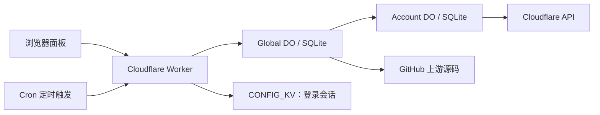

# Worker 智能中控 (V12.2.1)

> **版本状态**: V12.2.1 — 多账号 Worker 管理面板，支持 CMliu、Joey、ECH。2026-11-05 版本已完成构建、类型和静态检查，129 个测试文件 / 2811 项测试及 9 次真实本地 DO 重启验证。

你可以在一个网页里管理多个 Cloudflare 账号的 Worker：添加账号、配置变量、选择上游版本、部署或更新、查看用量、管理子域名，以及设置自动检查。

## 先选你要做的事

| 你的情况 | 从哪里开始 |
| --- | --- |
| 第一次接触，想在自己的空账号里搭一个基础面板 | **[新手部署教程](docs/DEPLOYMENT.md)**：安装工具 → 下载代码 → 创建 KV → 上传 → 设置密码 → 登录 |
| 面板已经部署好了，想添加账号或部署业务 Worker | **[使用教程](docs/USER_GUIDE.md)** |
| 已经运行 SQLite DO 权威版，准备升级 | **[升级与恢复](docs/OPERATIONS.md)**，不要执行新手新装命令 |
| 想理解后端和数据库，或继续开发 | **[架构](docs/ARCHITECTURE.md)**、[开发与测试](docs/DEVELOPMENT.md) |
| 需要处理维护、归档或未知任务 | **[维护协议](docs/RELIABILITY_MAINTENANCE.md)** |

## 有两种运行模式，请先看这一页

| 能力 | SQLite DO 权威模式 | KV 兼容模式 |
| --- | --- | --- |
| 定位 | 当前完整生产架构 | 已保留的旧版兼容路径；新手教程使用它创建全新基础面板 |
| 配置主存储 | Durable Objects 内的 SQLite | Workers KV |
| 部署执行 | 持久任务；接纳、执行、回执分开 | 旧请求执行流程 |
| 防止旧页面覆盖配置 | revision 校验 / CAS | 不具备同等保证，建议同一时间只开一个编辑页面 |
| 刷新后恢复任务状态 | 支持持久任务目录 | 不支持 DO 任务目录 |
| 面板中修改各项目兼容日期 | 支持 | 不支持，使用模板默认值 |
| 首次安装 | 需要独立密钥、来源证明和初始化/激活流程 | 可按新手教程从空配置部署 |
| 模式配置 | 默认选择；缺少配置时返回 503 | 必须显式设置 `CFAUTO_STORAGE_MODE=legacy`，且不能存在任何 `RELIABILITY_*` 配置 |

**目前没有面向任意新账号的一键 DO 初始化安装器。** 新手教程不会把“上传成功但配置未初始化”写成安装完成。若你需要完整持久任务能力，先阅读[权威模式部署边界](docs/OPERATIONS.md#3-首次安装权威模式需要什么)。已经使用 DO 的实例不能通过切到 legacy 来修复错误。

## 主要功能

- **账号**：API Token 或 Email + Global API Key；账号导入导出、用量、Worker 清单。
- **项目**：CMliu / Joey / ECH；上游版本、历史版本、收藏、自定义代码、变量和 Secret。
- **部署**：单项目更新、批量创建 Worker、部署预览、KV 绑定、域名设置。
- **运维**：诊断、子域名管理、删除资源、1101 修复、优选节点。
- **自动化**：按保存的间隔检查更新、用量阈值触发 UUID 轮换、通知。
- **权威模式专有**：任务回执、配置冲突保护、未知外部结果屏障、受控归档与恢复。

V12.2.1 重点优化了后端：同一请求只读一次登录会话；任务状态按页批量查询；四个 SQLite 索引减少历史数据扫描。详见[变更记录](CHANGELOG.md)和[后端审查记录](docs/BACKEND_AUDIT_2026-11-05.md)。

## 架构概览



图中是权威模式。兼容模式使用同一个网页和 Worker，配置读写走 KV，执行走旧路由。两条路径的边界见[架构说明](docs/ARCHITECTURE.md)。

源码采用原生 HTML/CSS/JavaScript + TypeScript，最终打包为一个 `dist/worker.js`，网页资源也包含在其中。

## 免费计划说明

项目保留 Worker + KV + SQLite DO 的部署体系，没有引入付费数据库服务。免费额度会限制请求、CPU、KV/SQLite 读写和存储；本地测试通过不代表所有账号数量和源码大小都能一直低于免费额度。相关官方说明和使用建议在[部署教程](docs/DEPLOYMENT.md#11-免费计划怎么用得更稳)。

## 本地开发

安装 Node.js 24（本版本验证环境为 24.19.0）和仓库声明的 pnpm 11.22.0，然后在项目目录执行：

```powershell
pnpm.cmd install --frozen-lockfile --ignore-scripts
node scripts/check.cjs
```

macOS / Linux 将 `pnpm.cmd` 写成 `pnpm`。完整命令说明见[开发指南](docs/DEVELOPMENT.md)。不要用 `npm install` 重新生成另一套依赖锁文件。

## 目录

```text
frontend/       网页、样式、交互和纯逻辑模块
src/index.ts    HTTP / Cron 入口
src/reliability/  SQLite DO、配置、任务、凭据、恢复
src/routes/     兼容模式路由及复用的只读实现
src/lib/        Cloudflare / GitHub / 校验等公共逻辑
scripts/        构建、验证和受控运维工具
test/           单元、集成、浏览器和本地 DO 测试
docs/           部署、使用、架构、开发、运维文档
```

`dist/` 是生成物；`.wrangler/`、个人配置、账号备份和密钥不提交。推送 Git 只会同步代码和触发仓库 CI，**不会自动替你部署 Cloudflare**。
