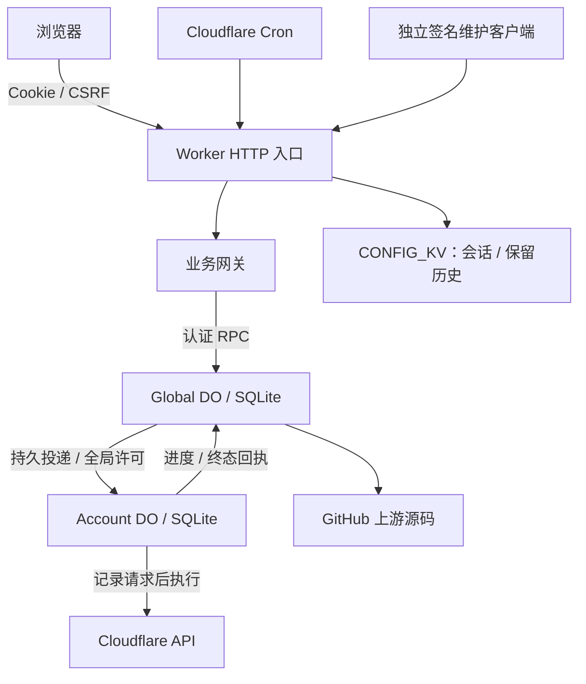
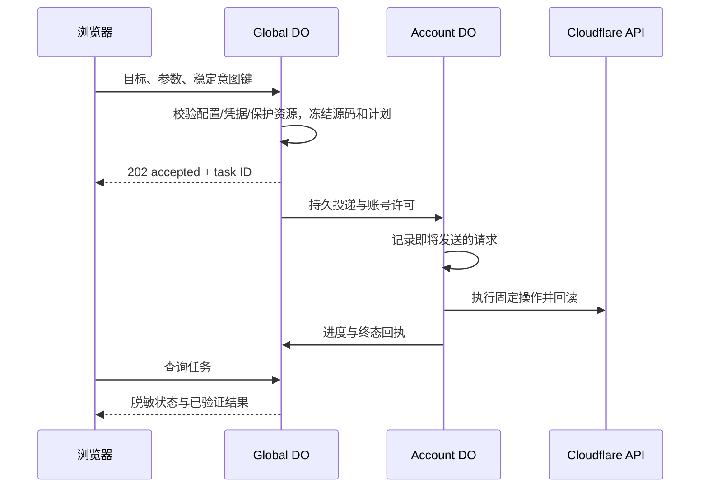

# 架构与数据库

本文对应 V12.2.1。先区分“中控 Worker”和“被管理的业务 Worker”：前者托管管理面板和 API，后者运行 CMliu / Joey / ECH 等上游代码。

## 1. 系统边界

前端使用原生 HTML/CSS/JavaScript；后端使用 TypeScript。`build.js` 编译 Tailwind、打包纯逻辑模块、按顺序拼接已有脚本，生成 `src/frontend-bundle.ts`，最后用 esbuild 输出单个 `dist/worker.js`。

网页、`/app.js`、`/app.css` 和 SweetAlert2 随 Worker 发布。主 HTML 不缓存；静态资源使用内容版本号。它不是另一个需要单独部署的 Vue/React 服务。

图中为权威模式。`ProductionCoordinator` 在同一 DO namespace 中，根据安装身份和角色创建全局对象及各账号对象。数据库位于 DO 内，未使用 D1、Redis 或 Cloudflare Queues。

## 2. 两种模式如何分流

`src/reliability/production-ingress.ts::reliabilityConfigured()` 默认选择权威模式。只有服务端明确设置 `CFAUTO_STORAGE_MODE=legacy`，且没有任何 `RELIABILITY_*` 槽，才走旧 KV 实现。

| 事项 | 权威模式 | 兼容模式 |
| --- | --- | --- |
| 配置主存储 | Global DO SQLite | CONFIG_KV |
| 写操作 | 经任务规划和账号 DO 执行 | 旧路由 / Cron 实现 |
| 配置并发 | generation / epoch / revision CAS | 无同等事务与版本保证 |
| 任务恢复 | 持久队列、快照、执行日志和回执 | 不提供 DO 任务目录 |
| 故障处理 | 配置缺失返回 503，拒绝旧 KV 回退 | 显式兼容路径 |

`src/routes` 不能整体当作废代码删除：兼容模式使用这些处理器，权威模式也复用部分只读实现。新手[部署教程](DEPLOYMENT.md)安装的是空白兼容实例；当前完整生产功能以权威模式为准。

## 3. 各层职责与入口

| 层 | 主要文件 | 职责 |
| --- | --- | --- |
| HTTP / Cron | `src/index.ts` | 公开入口、网页、模式分流、请求追踪 |
| 登录与认证 | `src/routes/login.ts`、`src/middleware/auth.ts` | ACCESS_CODE、Cookie、CSRF、请求内一次会话读取 |
| 业务协议 | `production-ingress.ts`、`business-gateway.ts` | 将浏览器配置、查询和操作意图转为内部 RPC |
| DO 组装 | `production-coordinator.ts`、`coordinator-endpoint.ts` | 身份校验、全局/账号角色、服务与 alarm |
| 配置 | `config-store.ts`、`config-editor.ts`、`config-projection.ts` | 事务、CAS、意图回执、读取投影 |
| 接纳与规划 | `business-admission.ts`、`application-intent.ts`、`business-planner.ts` | 稳定意图、资源校验、冻结源码与参数 |
| 执行 | `task-dispatch.ts`、`account-queue.ts`、`account-runner.ts`、`business-executor.ts` | 投递许可、串行步骤、外部 API 操作 |
| 执行证据 | `execution-journal.ts`、`business-effects.ts`、`deployment-ledger.ts` | 写前记录、事实投影、部署账本 |
| 自动化 | `automation-cycle.ts`、`automation-planner.ts`、`automation-flow.ts`、`webhook-outbox.ts` | Cron 周期、计划、任务和独立通知 |
| 凭据与恢复 | `credential-*`、`sealed-*`、`maintenance-*`、`generation-*` | 加密、撤销、签名维护、归档和代际激活 |

表中未带目录的后端文件均位于 `src/reliability/`。

## 4. 数据库分工

SQLite 表由对应存储类初始化，通过 `SqlDatabase` 抽象调用同步 SQL 和事务；测试使用真实 `node:sqlite`，生产使用 DO 的 `storage.sql` / `transactionSync`。

### Global DO：配置和协调

| 表组 | 保存什么 |
| --- | --- |
| `config_meta`、`authority_identity`、`authority_heads` | 当前安装、活动代际、epoch、维护状态 |
| `config_generations`、`config_records` | 分代配置；每个 domain 带 revision 和 JSON payload |
| `runtime_*` | 自动检查时间等运行状态及幂等回执 |
| `config_outbox`、`config_projection*` | 配置变更投递和读取进度 |
| `business_admissions` | 原始业务意图的身份、冻结规划的引用和接纳结果 |
| `dispatch_*` | 全局任务、账号投递、执行许可、取消与唤醒请求 |
| `business_facts`、`business_step_state` | 已校验步骤事实与当前步骤状态 |
| `deployment_runs`、`deployment_target_versions` | 部署范围、目标版本和结果 |
| `automation_*`、`webhook_outbox` | 自动化周期、模板任务、通知状态 |
| `credential_*`、`maintenance_*`、归档/代际表 | 凭据授权撤销、运维回执、恢复材料 |

### Account DO：串行执行

| 表组 | 保存什么 |
| --- | --- |
| `account_jobs` | 有序账号任务和取消状态 |
| `account_steps` | 步骤、执行令牌、状态和证据摘要 |
| `account_receipts` | 步骤回执 |
| `execution_calls` | 外部 HTTP 调用身份和确认状态 |
| `coordinator_inbox/progress/receipts` | 账号投递去重、进度与终态回传 |
| `sealed_objects`、`sealed_chunks` | 加密后的任务快照、请求/响应与归档内容 |

密封存储也由全局对象使用。表组清单用于解释职责，不代替完整 schema；新增或修改表应同时检查恢复、归档和重启测试。

## 5. 配置保存流程

1. 读取一个一致快照，得到 `generation + epoch + domain revision`。
2. 前端保留该基线和草稿，保存时附带稳定意图键。
3. Global DO 在同一 SQLite 事务中检查版本，再更新配置和 outbox。
4. 原意图重放返回原回执；旧 revision、旧代际或同键异内容返回冲突。

常见 domain：`accounts`、`autoConfig`、`vars:<type>`、`deploy:<type>`、`upstream:<type>`、`favorites:<type>`、`template:<type>`、`deployJournal`。账号级覆盖另有独立 domain。

`lastCheck` 等 runtime 与用户配置分开，旧页面不能把过时运行数据作为新配置覆盖。

## 6. 一次部署如何完成

- 当前最多三个账号同时持有全局许可；同一账号的写步骤串行。
- 源码、目标、变量、UUID/子域名选择、兼容日期在规划时冻结；恢复时不重新解析“最新版本”。
- 202 只代表持久接纳。关闭页面不会取消任务。
- 不能确认外部写结果时标记 `unknown`，保留许可与屏障。超时不自动重发写操作。
- 已证明没有记录任何外部写调用的特殊情况，可按受限规则归为确定失败；不能把它扩展为一般自动解锁。
- 取消只跳过尚未执行的步骤，不撤销已有远端效果。

## 7. V12.2.1 的性能设计

### 查询按页批量执行

`TaskCatalog` 先按账号归属和签名游标选当前页，再批量读取目标、步骤事实、自动化与部署结果。下一页探测项不加载详情。部署投影读取独立于建表类，不获取大计划 `payload`。

本地“返回一条任务、四账号 × 四十步骤、另有下一条任务”的场景，SQL 从 672 条降到 6 条。查询次数不是平台计费行数或线上响应时间。

### 四个索引

| 索引 | 解决的问题 |
| --- | --- |
| `config_outbox(acknowledged,id)` | 扫描未确认变更、计算待处理数量 |
| `account_jobs(state,cancel_requested,seq)` | 活跃容量、待执行队列 |
| `account_steps(state,job,ordinal)` | in-flight / unknown 屏障与恢复 |
| `automation_lanes(task)` | 任务归属和自动化回执关联 |

使用 `CREATE INDEX IF NOT EXISTS`，保留表和历史记录。索引增加存储和写入维护成本；首次创建也有成本，发布前需要评估已有数据规模。

### 会话只读一次

authority API 由业务网关统一认证，同一请求的会话/CSRF 检查共用一次 KV 读取，不跨请求缓存认证结果。实际 GET 读取由 2 次降到 1 次，POST 由 4 次降到 1 次。

## 8. 安全与数据大小边界

面板登录、内部 RPC、幂等摘要、执行证据、凭据加密、快照加密和维护操作者使用独立用途的密钥。普通 API 只返回脱敏视图；维护入口独立签名，不把浏览器会话升级为运维权限。

中控 Worker、配置 KV 和声明的附加资源受保护。上游读取限固定仓库/约定地址；账号执行限制目标账号，防止将凭据发送给任意 URL。

| 内容 | 代码上限 |
| --- | --- |
| 固定上游源码 | 8 MiB |
| Worker 脚本读取及对应日志响应 | 10 MiB |
| 解密后的逻辑快照 / 内部大响应 | 16 MiB |
| 加密持久化对象 | 5 MiB |
| 公开业务任务 JSON | 2 MiB |
| 配置 JSON | 128 KiB |
| 普通外部只读 JSON | 2 MiB |

大于 4 MiB 的内部 JSON 使用版本化 gzip 帧后再认证加密。解压有硬上限，无法装入就拒绝，不截断；同账号快照共享相同源码。源码读取上限不表示公开上传获得同样预算。

这些是项目自己的边界；还受 Cloudflare 免费计划 CPU、读写、子请求及存储限制。旧代码可能不认识新压缩帧，回滚必须先检查数据格式兼容。

## 9. 修改架构时的检查点

- HTTP 写操作是否仍进入当前模式的正式链路？
- 是否在同一事务提交配置、回执和投影事件？
- 重复请求、断网和进程重启后会不会重复外部写？
- 新读取是否泄露密钥、原始 provider 响应或执行计划？
- 新索引和表是否影响历史归档/恢复？
- 新任务或模板是否补齐测试和允许的协议字段？

验证流程见[开发指南](DEVELOPMENT.md)，上线与回滚见[运维指南](OPERATIONS.md)。
